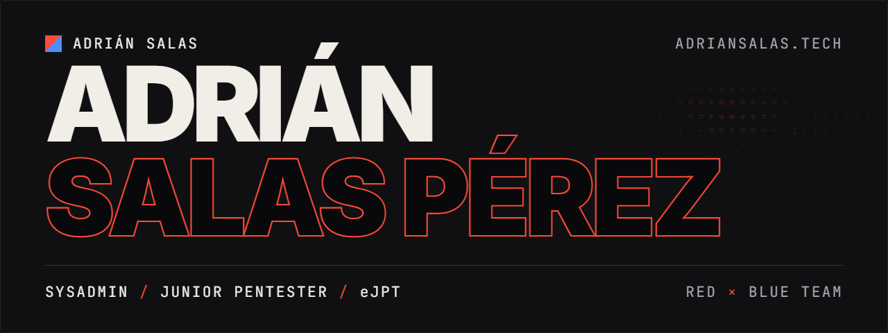

<a href="https://adriansalas.tech"></a>

### Sysadmin by day. Breaking my own lab by night.

I'm Adrián, a systems administrator from Palencia, Spain, working my way into offensive security.
I keep production servers running for a living. At home I build networks so I can attack them and see where they give way.

[](https://adriansalas.tech)
[](https://www.linkedin.com/in/adriansalastech/)
[](mailto:adrian@adriansalas.tech)
<br>


---

## What I've built

### [palantir](https://github.com/salitress/palantir) — recon that stops where exploitation starts

[](https://github.com/salitress/palantir/releases)
[](https://github.com/salitress/palantir/actions/workflows/selftest.yml)
[](https://github.com/salitress/palantir/blob/main/LICENSE)
[](https://github.com/salitress/palantir/stargazers)

An nmap-driven recon scanner for authorised labs and engagements (HTB, CPTS, OSCP).
One command takes a target from port discovery to a report:

```text
ping sweep → ports → service enumeration → UDP → banner grabbing
           → per-protocol footprinting (SMB, LDAP, Kerberos, MSSQL, NFS, SNMP, web…)
           → known exploits (searchsploit, offline) → verified default credentials
           → web and vhost fuzzing → HTML / Markdown report
```

Everything it does is read-only. Nothing is exploited automatically: each next step is left as a command ready to copy.
A single Python 3 file with a standard-library-only core; every external tool is optional and skipped if it's missing.

### [kerbrute](https://github.com/salitress/kerbrute) — a fork I fixed before I trusted it


I read the whole codebase before changing anything, and found five real bugs:

- `--delay` never actually forced a single thread, so "slow" runs still sent requests in parallel.
- `-o / --output` wrote nothing: a second internal logger silently replaced the configured one.
- Windows-format wordlists (`\r\n`) corrupted usernames and passwords without any warning.
- `KDC_ERR_ETYPE_NOSUPP` aborted the whole run instead of skipping that one account.
- A duplicated error check that was dead code.

Then I added what I was missing: `--jitter` to randomise the delay, `--lockout-threshold` to stop trying an account before it locks, and `--json` for clean NDJSON output that pipes into `jq`.

### [Honeypot SIEM](https://adriansalas.tech/proyectos/honeypot/) — real attackers, watched live

[](https://adriansalas.tech/proyectos/honeypot/dashboard/)

A Cowrie SSH honeypot feeding Elasticsearch through native ingest pipelines, with Kibana on top and a Python bot that sends alerts to Telegram. It runs on my own Proxmox and pfSense, and it was my final-year project for ASIR (2026).
The dashboard is public: **[see who is knocking right now](https://adriansalas.tech/proyectos/honeypot/dashboard/)**.

---

## Where I am on the road

```text
[x]  SMR      Microcomputer Systems and Networks (vocational diploma)
[x]  ASIR     Network Systems Administration (higher vocational diploma)
[x]  eJPTv2   INE Security — 88 %, September 2026
[~]  CPTS     Hack The Box — in progress
[ ]  CWES     Hack The Box
[ ]  OSCP     OffSec
[ ]  OSEP     OffSec
```

## Day job

**Systems Administrator at ICON Multimedia** (Palencia), since March 2026: production servers, Windows Server roles, VMware vSphere and Proxmox, and pfSense with VLANs, firewalling and NAT.

## What I work with


**Systems** &nbsp; GNU/Linux / Windows Server / Proxmox VE / VMware vSphere / Docker<br>
**Networks** &nbsp; pfSense / VLANs / Cisco / DNS and DHCP / firewalls and ACLs<br>
**Offence** &nbsp; nmap / NetExec / Impacket / ffuf / searchsploit / Active Directory<br>
**Defence** &nbsp; Elastic Stack (SIEM) / honeypots / hardening<br>
**Code** &nbsp; Python / Bash / Git

## How I work

- **By hand first.** I automate a step only once I've done it manually enough times to know what it should do.
- **Read before running.** If I'm going to depend on a tool, I read its code. That is how the kerbrute fixes happened.
- **Write it down.** Every module I study and every box I break ends up in my notes.

---

Open to junior roles in pentesting or SOC, on-site in Spain or remote. Spanish is my native language and my English is B2.
The quickest way to reach me is [adrian@adriansalas.tech](mailto:adrian@adriansalas.tech).
